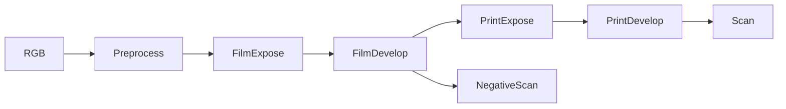

# Architecture audit (checked-out sources)

## Observed facts

The original repository and OFX are separate implementations. The original installed
package is 0.3.4 and requires Python ~=3.13. At this SHA `create_params` is NOT
exported: use `init_params`, `digest_params`, `Simulator`, `simulate`. The online
README/API examples can differ from this checkout.

Python call chain: GUI (`spektrafilm_gui/app.py`, controller) or LUT builder
(`spektrafilm_lut_creator/builders.py`) → runtime/process.py →
SimulationPipeline (runtime/pipeline.py) → topology:

FilmExpose performs spectral upsampling, camera exposure, diffusion and halation
before development. FilmDevelop applies density curves, couplers and grain.
PrintExpose projects negative transmittance onto print media; PrintDevelop forms
print density; Scan integrates spectral light and converts to output RGB.
See runtime/stages/{filming,printing,scanning}.py; model/{develop,couplers,
density_curves,grain,diffusion}.py; utils spectral conversion helpers.
Spectral tensors/einsum, spatial convolution, stochastic grain and Numba first-run
compilation are expected expensive operations (cost attribution requires measured timings).

OFX: host image/parameter plumbing in C++ → `VulkanRenderer::render(ImageView,
MutableImageView, RenderWindow, RenderParams, double time)` → format conversion,
spectral FilmExposure, Halation/Diffusion, CurveDevelop/DIR/Grain, PrintScan,
ScannerPost GLSL compute shaders. Generated profile curves and spectral tables are
build-time Python products in the build directory. VulkanRenderer has no OFX
host dependency in its public API. The existing VulkanCopyHarness calls it directly
and also validates core, print/scan and spatial passes, with float/half cases.
The other Perf/Evaluation/Parity harness targets are inside the Apple branch.
The Vulkan harness is a synthetic test runner, not a general media renderer.

Minimal offline integration: compile the unchanged VulkanRenderer.cpp and generated
profile C++ into a separate library, expose a narrow float RGBA C ABI, and handle
FFmpeg/media/streaming in a separate Python process. Keep all upstream data,
profile indices and shader code authoritative. Do not add a new film algorithm.
Use separate build directories with an explicit SDK path, so the README's nested
OFX/SpektraFilm layout is unnecessary. Upstream worktrees remain unmodified.

Native CUDA addition: `cuda_spectral_tables.cpp` reuses the same upstream CPU
spectral/diffusion preparation helpers without constructing a Vulkan renderer.
`cuda_spectral.cu` runs the current linear Rec.709/default print pipeline on CUDA.
Halation/diffusion/grain arithmetic is syntax-translated from pinned GLSL using
`generate_cuda_effects.py` and GLM; exposure/development/81-band integration are
native CUDA ports. CUDA operation specialization and two-component diffusion
groups preserve the upstream order. NumPy/ctypes and the existing subprocess
media layer transport frames. See CUDA_BACKEND.md for the actual tested scope.
The optimized adapter transfers packed RGB/RGBA directly, uses shared-memory
tiles for full-resolution Gaussian passes (with the same large-radius fallback),
and reuses developed film density for temporal grain instead of repeating the
exposure/spatial stages. Final temporal residual mixing preserves FP32 subtraction
and FP64 scalar arithmetic from NumPy. See CUDA_OPTIMIZATION.md for A/B checks.

## Verification boundary

Successful compilation or harness rendering is not verification inside Resolve.
CPU Python and OFX ship different profile registries and defaults; their numeric
outputs cannot be claimed identical without matched settings and reference tests.
The standalone bridge, temporal semantics and media behavior require their own tests.

## Function matrix (updated after local tests)

| Feature | Python upstream | OFX upstream | Offline CLI | ComfyUI bridge |
|---|---|---|---|---|
| Spectral film/print/scan | runtime tested | GPU bridge tested; OFX host untested | Vulkan, native CUDA + CPU physical tested | live host image/video API tested |
| GUI | Qt/napari | OFX host | no | existing host only |
| LUT export | official 33³/65³ exports; QA has failures | host export untested | use official Python CLI separately | no LUT node |
| Halation/diffusion/grain | deterministic color + spatial API exists | Vulkan passes implemented; upstream harness count failures | Vulkan + native CUDA halation/camera diffusion/preview grain tested | Vulkan/CUDA subprocess effects tested |
| General MP4 decode/encode | no media CLI | host provides | SDR H.264/H.265 + audio tested | no VideoFile/VHS node |
| Stateless segmented processing | CPU deterministic color tested | animation parameter quantizes 24 Hz | absolute grain index + EXR overlap exact | subprocess segment overlap exact |
| Runtime proof on this machine | TIFF/EXR, 829 tests pass, 5 fail; GUI offscreen | Debug/Release and float/half copy; no Resolve | Vulkan/CUDA 720p/1080p 250-frame streams; Vulkan 4K one frame | 3 nodes installed; host Python/dependencies preserved; native CUDA live image/video tested |

Optional rho>0 temporal correlation is an explicitly labeled bridge extension
that mixes upstream grain residuals in linear output. Default rho=0 uses upstream
grain directly. It is not native OFX temporal correlation or an AR(1) model.
